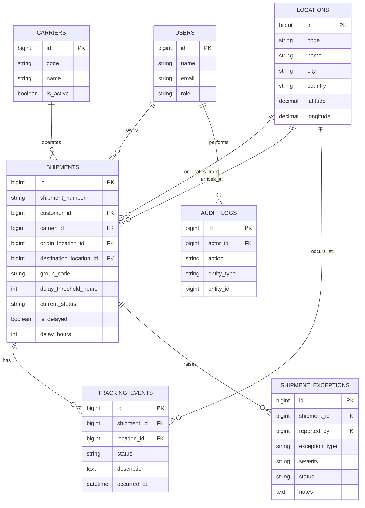

# CargoTrace — Maritime Shipment & Port Tracking Platform


**CargoTrace** is a web-based maritime logistics and shipment visibility platform built with **Laravel** for tracking consignments, enforcing status lifecycles, monitoring SLA delay thresholds, visualizing port and waypoint routes on an interactive map, retrieving external weather conditions, managing operational exceptions and notifications, switching web UI languages between **Indonesian (`id`)** and **English (`en`)**, and exposing JSON REST API endpoints.

## Table of Contents

1. [Project Overview & Problem Statement](#project-overview--problem-statement)
2. [Key Features & Business Rules](#key-features--business-rules)
3. [System Architecture & Database ERD](#system-architecture--database-erd)
4. [Tech Stack](#tech-stack)
5. [Local Installation & Setup Guide](#local-installation--setup-guide)
6. [REST API Documentation](#rest-api-documentation)
7. [Hosting & Production Deployment](#hosting--production-deployment)
8. [Automated Testing](#automated-testing)
9. [Known Limitations & Future Work](#known-limitations--future-work)
10. [Author & Course Info](#author--course-info)

## Project Overview & Problem Statement

Maritime freight operations often face fragmented status updates, manual delay estimation, and late visibility into port or customs disruptions between origin and destination terminals. **CargoTrace** centralizes shipment tracking, deterministic delay and SLA evaluation, exception reporting, geospatial route visualization, bilingual web UI support, and API integration within a structured Laravel application.

## Key Features & Business Rules

### 1. Role-Based Access Control (RBAC)
- **Administrator (`admin`)**: Full management access across carriers, port locations, users, shipments, tracking events, exceptions, and audit logs.
- **Logistics Operator (`operator`)**: Creates shipments, records chronological tracking milestones, updates schedules/ETAs, and manages operational exceptions.
- **Customer (`customer`)**: Views shipments assigned to their own account, inspects tracking timelines, route maps, weather feeds, and active alerts/exceptions.

### 2. Bilingual Web Interface (Indonesian & English)
- Supports switching between **Indonesian (`id`, default)** and **English (`en`)** on the web interface across guest/auth views and all authenticated roles (`admin`, `operator`, and `customer`) via `GET /lang/{locale}`, `SetLocale` web middleware, session state, and `lang/id.json` + `lang/en.json` translation dictionaries without altering REST API responses.

### 3. Shipment Lifecycle & Status Progression
- Tracks shipment progress through core stages (`CREATED`, `BOOKED`, `PICKED_UP`, `IN_TRANSIT`, `DELIVERED`) via `ShipmentLifecycleService`.
- Enforces workflow validation so invalid transitions are rejected cleanly while valid checkpoints update the shipment's current state and timeline.

### 4. Chronological Tracking Timeline
- Records tracking checkpoints with status, location/port reference, timestamp, description/notes, and reporter metadata.
- Distinguishes standard progress milestones from exception-related events for clear operational traceability.

### 5. SLA Monitoring & Delay Evaluation
- Evaluates delay thresholds and SLA compliance across groups (**Group A: 12h**, **Group B: 18h**, **Group C: 24h**) via `ShipmentSlaService`.
- Calculates delay status and overdue hours when expected/estimated arrival thresholds are exceeded, updating shipment delay flags and severity indicators.

### 6. Operational Exception & Notification Management
- Supports reporting and resolving shipment exceptions (such as customs holds, weather delays, port congestion, damaged cargo, or documentation issues).
- Tracks exception lifecycle states (`open`, `investigating`, `resolved`) with resolution timestamps and triggers notifications/audit records.

### 7. Interactive Route Map (Leaflet.js + OpenStreetMap)
- Renders origin terminals, intermediate checkpoints/waypoints, and destination ports on an interactive map using **Leaflet.js** and OpenStreetMap tiles.
- Connects route coordinates with polylines and popups showing location and milestone details.

### 8. External Weather Integration (Open-Meteo)
- Fetches weather data for shipment/port coordinates from **Open-Meteo** via `MaritimeWeatherService` using Laravel's `Http` client.
- Includes caching, request timeout handling, and safe fallback responses when coordinates are unavailable or external APIs cannot be reached.

### 9. Analytics, Notifications & Audit Trail
- Provides dashboard summaries, shipment filtering/search, notifications, and audit logs (`AuditLog`) recording key actions.

## System Architecture & Database ERD

CargoTrace follows a layered Laravel architecture separating routes (`routes/web.php` with `SetLocale` web middleware and `routes/api.php` registered in `bootstrap/app.php`), controllers (`Web` & `Api\CargoTraceApiController`), middleware (`api.auth` via `ApiBearerAuth`, storing SHA-256 token hashes in cache under `cargotrace:api_token:{hash}`), domain services (`ShipmentLifecycleService`, `ShipmentSlaService`, `MaritimeWeatherService`), and Eloquent models.



## Tech Stack

| Component | Technology | Purpose |
| :--- | :--- | :--- |
| **Framework** | Laravel | Web routes, MVC controllers, service layer, Eloquent ORM, migrations & seeders |
| **Language** | PHP 8.2+ | Backend application logic and test suite |
| **Localization** | `SetLocale` + JSON Lang (`id` / `en`) | Bilingual web UI switching across roles without affecting REST API responses |
| **API Authentication** | Bearer Token (`api.auth`) | SHA-256 token lookup via `ApiBearerAuth` middleware and cache store (`cargotrace:api_token:{hash}`) |
| **Database & Testing** | MySQL / SQLite (`:memory:`) | Application persistence and PHPUnit `RefreshDatabase` feature tests |
| **Frontend Styling** | Blade & Tailwind CSS | Web UI views, layout styling, and responsive components |
| **Interactive Mapping** | Leaflet.js & OpenStreetMap | Port markers, checkpoints, and maritime route polylines |
| **External Weather API** | Open-Meteo | Live/cached weather data with timeout and fallback handling |

## Local Installation & Setup Guide

1. Clone the repository and navigate into the project folder:
   ```bash
   git clone [https://github.com/silmyarifah26-byte/CargoTrace.git](https://github.com/silmyarifah26-byte/CargoTrace.git)
   cd Cargo_Trace
   ```
2. Install PHP dependencies:
   ```bash
   composer install
   ```
3. Copy `.env.example` to `.env` and generate the application key:
   ```bash
   cp .env.example .env
   php artisan key:generate
   ```
4. Configure your MySQL database and cache connection in `.env`, then run migrations and seeders:
   ```bash
   php artisan migrate --seed
   ```
5. Start the local development server:
   ```bash
   php artisan serve
   ```

## REST API Documentation

Protected endpoints require the header `Authorization: Bearer <token>` and `Accept: application/json`.

### Authentication & User
- `POST /api/register` — Register a new user and issue a Bearer token
- `POST /api/login` — Authenticate with `email` and `password` to receive a Bearer token
- `POST /api/logout` — Revoke the active Bearer token
- `GET /api/user` — Return the authenticated user profile

### Shipments & Tracking Events
- `GET /api/shipments` — List shipments (supports pagination, `status`, `group_code`, and `search`; scoped by role)
- `POST /api/shipments` — Create a new shipment (`admin` / `operator`)
- `GET /api/shipments/{shipment}` — Retrieve shipment details, relations, and SLA evaluation
- `PUT / PATCH /api/shipments/{shipment}` — Update shipment fields and re-evaluate SLA (`admin` / `operator`)
- `DELETE /api/shipments/{shipment}` — Delete a shipment (`admin`)
- `GET /api/shipments/{shipment}/tracking` — List chronological tracking events for a shipment
- `POST /api/shipments/{shipment}/tracking` — Record a new tracking event (`admin` / `operator`)

### Carriers, Locations & Exceptions
- `GET /api/carriers` & `POST /api/carriers` — List or create carriers (`POST` requires `admin`)
- `GET /api/locations` & `POST /api/locations` — List (with optional `search`) or create port/location records (`POST` requires `admin`)
- `GET /api/shipments/{shipment}/exceptions` — List exceptions for a shipment
- `POST /api/shipments/{shipment}/exceptions` — Create an exception for a shipment (`admin` / `operator`)
- `PATCH /api/exceptions/{exception}` — Update exception status (`open`, `investigating`, `resolved`) and notes (`admin` / `operator`)

### Sample Postman Payloads

Login (`POST /api/login`):
```json
{
  "email": "admin@cargotrace.test",
  "password": "password123"
}
```

Create Shipment (`POST /api/shipments`):
```json
{
  "shipment_number": "CT-2026-C002",
  "carrier_id": 3,
  "origin_location_id": 1,
  "destination_location_id": 94,
  "group_code": "A",
  "cargo_type": "General Maritime Cargo",
  "weight_kg": 1500
}
```

## Hosting & Production Deployment

1. Export the local MySQL database (`Cargo_Trace`) from XAMPP (`phpMyAdmin` or `mysqldump`) into a `.sql` backup file and import it into the hosting database.
2. Upload the project files to the hosting server and configure `.env` directly on the server (never commit `.env` to Git):
   - Set `APP_ENV=production` and `APP_DEBUG=false`.
   - Set `APP_URL` and production `DB_*` credentials.
   - Ensure the configured cache driver (`CACHE_STORE`) works reliably so `cargotrace:api_token:{hash}` tokens remain valid across requests.
3. Verify live endpoints (`POST /api/login`, `GET /api/shipments`, and `POST /api/shipments`) against the deployed URL before the **December 1, 2026** deadline.

## Automated Testing

Run the PHPUnit / Pest feature and unit test suite with:

```bash
php artisan test
```

Key test coverage in `tests/Feature/CargoTraceApiAndLifecycleTest.php` includes:
- Unauthenticated API rejection (`401`) and login token issuance (`200`)
- Role-based shipment list scoping and single-shipment access control (`200` vs. `403`)
- Tracking event creation, lifecycle status updates, SLA delay detection, and open exception creation

## Known Limitations & Future Work

- External map tiles and **Open-Meteo** weather lookups depend on network reachability (with fallback handling when offline or timed out).
- Future enhancements can include real-time AIS vessel feeds, expanded webhook/notification channels, and deeper role/permission policies.

## Author & Course Info

- **Author**: Silmy Arifah (`silmyarifah26-byte`)
- **Affiliation**: Information Systems — Universitas Malikussaleh