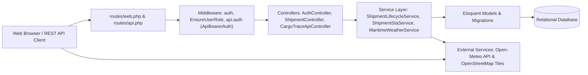

# Cargo_Trace — System Architecture, ERD & Data Dictionary

## 1. System Architecture Diagram

Cargo_Trace separates HTTP routing, authentication/role middleware, controllers, domain services, and Eloquent persistence so business rules remain testable and independent of presentation layers.

### Layer Responsibilities
- **Routes & Middleware**: Separates session-based web routes (`routes/web.php`) from stateless Bearer-token JSON endpoints (`routes/api.php` protected by `ApiBearerAuth` and `EnsureUserRole`).
- **Controllers**: Handles request validation, authorization checks, and response formatting (`AuthController`, `ShipmentController`, `CargoTraceApiController`).
- **Service Layer**: Encapsulates status lifecycle validation (`ShipmentLifecycleService`), deterministic SLA/delay evaluation (`ShipmentSlaService`), and external weather retrieval with caching/fallback (`MaritimeWeatherService`).
- **Models & Persistence**: Eloquent ORM models backed by relational migrations and `CargoTraceSeeder`.

---

## 2. Entity-Relationship Diagram (ERD)

```mermaid
erDiagram
    USERS ||--o{ SHIPMENTS : "owns (customer_id)"
    USERS ||--o{ TRACKING_EVENTS : "records (recorded_by)"
    USERS ||--o{ SHIPMENT_EXCEPTIONS : "reports (reported_by)"
    USERS ||--o{ NOTIFICATIONS : "receives (user_id)"
    USERS ||--o{ AUDIT_LOGS : "performs (actor_id)"
    CARRIERS ||--o{ SHIPMENTS : "operates (carrier_id)"
    LOCATIONS ||--o{ SHIPMENTS : "origin (origin_location_id)"
    LOCATIONS ||--o{ SHIPMENTS : "destination (destination_location_id)"
    LOCATIONS ||--o{ TRACKING_EVENTS : "checkpoint (location_id)"
    SHIPMENTS ||--o{ SHIPMENT_ITEMS : "contains (shipment_id)"
    SHIPMENTS ||--o{ TRACKING_EVENTS : "logs (shipment_id)"
    SHIPMENTS ||--o{ SHIPMENT_EXCEPTIONS : "triggers (shipment_id)"
    SHIPMENTS ||--o{ NOTIFICATIONS : "references (shipment_id)"

    USERS {
        bigint id PK
        string name
        string email UK
        string password
        string role
        timestamps created_at_updated_at
    }

    CARRIERS {
        bigint id PK
        string code UK
        string name
        boolean is_active
        timestamps created_at_updated_at
    }

    LOCATIONS {
        bigint id PK
        string code UK
        string name
        string city
        string country
        decimal latitude
        decimal longitude
        timestamps created_at_updated_at
    }

    SHIPMENTS {
        bigint id PK
        string shipment_number UK
        bigint customer_id FK
        bigint carrier_id FK
        bigint origin_location_id FK
        bigint destination_location_id FK
        string group_code
        int delay_threshold_hours
        string current_status
        string cargo_type
        decimal weight_kg
        datetime expected_arrival_at
        datetime estimated_arrival_at
        boolean is_delayed
        int delay_hours
        timestamps created_at_updated_at
    }

    SHIPMENT_ITEMS {
        bigint id PK
        bigint shipment_id FK
        string item_name
        int quantity
        decimal weight_kg
        timestamps created_at_updated_at
    }

    TRACKING_EVENTS {
        bigint id PK
        bigint shipment_id FK
        bigint location_id FK
        bigint recorded_by FK
        string status
        text description
        datetime occurred_at
        timestamps created_at_updated_at
    }

    SHIPMENT_EXCEPTIONS {
        bigint id PK
        bigint shipment_id FK
        bigint reported_by FK
        string exception_type
        string severity
        string status
        text notes
        datetime resolved_at
        timestamps created_at_updated_at
    }

    NOTIFICATIONS {
        bigint id PK
        bigint user_id FK
        bigint shipment_id FK
        string title
        text message
        boolean is_read
        timestamps created_at_updated_at
    }

    AUDIT_LOGS {
        bigint id PK
        bigint actor_id FK
        string action
        string entity_type
        bigint entity_id
        json metadata
        timestamps created_at_updated_at
    }
```

### Cardinality & Relationship Summary
- **`users` → `shipments` (`1:N`)**: One customer user can own many shipments; each shipment belongs to one customer (`customer_id`).
- **`carriers` → `shipments` (`1:N`)**: One carrier operates many shipments (`carrier_id`).
- **`locations` → `shipments` (`1:N` twice)**: Separate foreign keys (`origin_location_id` and `destination_location_id`) link each shipment to its departure and arrival ports without duplicating location master data.
- **`shipments` → `shipment_items` (`1:N`)**: One shipment can contain multiple itemized cargo entries (`shipment_id`).
- **`shipments` → `tracking_events` (`1:N`)**: Tracking checkpoints are stored as append-only historical records rather than overwriting previous statuses.
- **`shipments` → `shipment_exceptions` (`1:N`)**: A shipment can have multiple operational exceptions (`open`, `investigating`, `resolved`) tracked independently from normal voyage statuses.
- **`users` → `notifications` & `audit_logs` (`1:N`)**: Stores user-specific operational alerts and immutable audit trails for key mutations.

---

## 3. Data Dictionary (Core Tables)

| Table | Key Columns | Constraints & Indexes | Purpose |
| :--- | :--- | :--- | :--- |
| `users` | `id`, `name`, `email`, `password`, `role` | `PK(id)`, `UNIQUE(email)` | Stores system accounts with `admin`, `operator`, and `customer` roles. |
| `carriers` | `id`, `code`, `name`, `is_active` | `PK(id)`, `UNIQUE(code)` | Master list of maritime carriers/shipping lines. |
| `locations` | `id`, `code`, `name`, `city`, `country`, `latitude`, `longitude` | `PK(id)`, `UNIQUE(code)` | Port and terminal master data with geospatial coordinates for Leaflet maps and weather lookups. |
| `shipments` | `id`, `shipment_number`, `customer_id`, `carrier_id`, `origin_location_id`, `destination_location_id`, `group_code`, `delay_threshold_hours`, `current_status`, `cargo_type`, `weight_kg`, `expected_arrival_at`, `estimated_arrival_at`, `is_delayed`, `delay_hours` | `PK(id)`, `UNIQUE(shipment_number)`, `FK` to `users`, `carriers`, `locations` | Core shipment record holding SLA parameters, schedule timestamps, and current lifecycle state. |
| `shipment_items` | `id`, `shipment_id`, `item_name`, `quantity`, `weight_kg` | `PK(id)`, `FK(shipment_id)` | Line-item cargo breakdown per shipment. |
| `tracking_events` | `id`, `shipment_id`, `location_id`, `recorded_by`, `status`, `description`, `occurred_at` | `PK(id)`, `FK` to `shipments`, `locations`, `users` | Chronological, append-only voyage milestones and checkpoint history. |
| `shipment_exceptions` | `id`, `shipment_id`, `reported_by`, `exception_type`, `severity`, `status`, `notes`, `resolved_at` | `PK(id)`, `FK` to `shipments`, `users` | Tracks operational disruptions (`CUSTOMS_HOLD`, `WEATHER_DELAY`, etc.) and resolution lifecycle. |
| `notifications` | `id`, `user_id`, `shipment_id`, `title`, `message`, `is_read` | `PK(id)`, `FK` to `users`, `shipments` | In-app operational and SLA alert notifications. |
| `audit_logs` | `id`, `actor_id`, `action`, `entity_type`, `entity_id`, `metadata` | `PK(id)`, `FK(actor_id)` | Records who performed critical state changes and when. |

---

## 4. Key Engineering & Design Decisions

1. **Append-Only Tracking History**: New checkpoints insert rows into `tracking_events` instead of overwriting previous records, preserving a complete audit trail for customer timelines and delay investigations.
2. **Service-Layer Isolation**: Lifecycle transitions (`ShipmentLifecycleService`), SLA threshold checks (`ShipmentSlaService`), and external weather queries (`MaritimeWeatherService`) live in dedicated services so both Web and REST API controllers share identical business rules.
3. **Configurable SLA Thresholds per Group**: Storing `group_code` (`A`, `B`, `C`) and `delay_threshold_hours` (`12`, `18`, `24`) per shipment allows deterministic SLA evaluation without hardcoding a single global constant.
4. **Resilient Weather Integration**: `MaritimeWeatherService` uses Laravel's `Http` client with caching, request timeout limits, and graceful fallback output so map/detail pages remain usable even when external APIs fail or coordinates are absent.
5. **Server-Side Authorization**: Ownership and role checks are enforced on backend routes and API controllers (verified via automated feature tests in `tests/Feature/CargoTraceApiAndLifecycleTest.php`), rather than relying on UI-level hiding.

---

## 5. Third-Party Attribution

- **Laravel & PHP**: Application framework, routing, Eloquent ORM, migrations, and PHPUnit testing harness.
- **Tailwind CSS**: Utility-first styling for web views and operational dashboards.
- **Leaflet.js & OpenStreetMap**: Interactive map rendering and map tiles (`© OpenStreetMap contributors`).
- **Open-Meteo API**: Free meteorological forecast endpoint used for port/destination weather context.